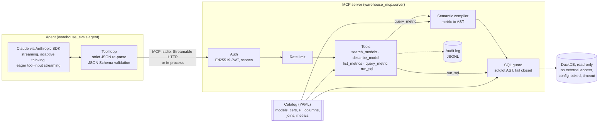

# governed-warehouse-mcp

[](https://github.com/tongliuTL/governed-warehouse-mcp/actions/workflows/ci.yml)


A governed [Model Context Protocol](https://modelcontextprotocol.io) server that lets AI agents
answer questions from an analytical warehouse. Agents cannot write to the warehouse, read data
their token does not allow, or see personal data they are not cleared for. The repository also
has an eval harness for tool-calling agents. It runs the real Anthropic SDK and the real MCP
server end to end, and it runs offline, so CI needs no API key.

The warehouse is a synthetic cross-border freight dataset (shipments, carriers, lanes, border
crossings, customs documents, invoices, quotes). It is generated deterministically from a seed,
and nothing in it is real.

```text
$ uv run gwm-eval all --gate
wrote reports/report.md and reports/report.json
all gates passed
```

## Contents

- [Why it exists](#why-it-exists)
- [What an agent sees](#what-an-agent-sees)
- [Architecture](#architecture)
- [Quickstart](#quickstart)
- [Evals](#evals)
- [Configuration](#configuration)
- [Extending the catalog](#extending-the-catalog)
- [Development](#development)
- Docs: [architecture and design decisions](docs/architecture.md) ·
  [threat model](docs/threat-model.md) · [eval methodology](docs/evals.md) ·
  [latest eval report](docs/eval-report.md) · [contributing](CONTRIBUTING.md) ·
  [security](SECURITY.md) · [changelog](CHANGELOG.md)

## Why it exists

Letting an LLM agent query a warehouse is easy. Letting it do so safely, and knowing whether it
answers correctly, is the hard part. This repository does both:

- **The server** puts a semantic layer, an access policy and a SQL guard between the agent and
  the data. Agents ask for governed metrics by name, or write SQL. Agent SQL is parsed, checked
  and regenerated before it runs on a read-only, sandboxed connection. Every call is audited.
- **The eval harness** measures an agent on that server. It checks whether the agent answers
  correctly, respects governance, and resists prompt injection planted in the data. The graders
  are deterministic, and they are themselves tested against planted failures.

## What an agent sees

Five tools and one resource:

| tool | what it does |
|---|---|
| `search_models` | ranks the models and metrics the caller may see for a plain-language question |
| `describe_model` | returns grain, tier, columns (with which are PII), joins and metrics for one model |
| `list_metrics` | lists governed metrics with definitions, time column and allowed dimensions |
| `query_metric` | computes a metric by name, grouped, filtered and bucketed by time; returns the SQL that ran |
| `run_sql` | runs one read-only SELECT over visible catalog models, after the guard checks it |
| `catalog://version` | resource: the published catalog version and its tiers |

A metric query returns rows together with how they were produced. These are real responses for
the `analyst` role; the data is synthetic:

```jsonc
// query_metric {"metric": "on_time_rate", "group_by": ["dim_lanes.border_crossing"],
//               "start_date": "2025-01-01", "end_date": "2025-12-31"}
{
  "columns": ["border_crossing", "on_time_rate"],
  "rows": [[null, 0.873348], ["Detroit-Windsor", 0.788462], ["El Paso", 0.765799],
           ["Laredo", 0.753898], ["Buffalo", 0.752964], ["Nogales", 0.752092]],
  "truncated": false,
  "sql": "SELECT \"dim_lanes\".\"border_crossing\" AS \"border_crossing\", AVG(CASE WHEN ...) ...",
  "models": ["dim_lanes", "fct_shipments"],
  "catalog_version": "v1-42c3e5f7aec9"
}
```

Refusals start with a stable code, so an agent can recover and an eval can grade without
parsing prose:

```text
run_sql "select contact_email from dim_customers limit 3"
  PII_DENIED: column 'contact_email' is PII and needs the pii:read scope

run_sql "select sum(amount_usd) from fct_invoices"          (restricted model)
  UNKNOWN_MODEL: 'fct_invoices' is not a model you can query; use search_models to find one

run_sql "drop table fct_invoices"
  READ_ONLY: only SELECT queries are allowed, got DROP
```

A restricted model gets the same answer as a model that does not exist, so a refusal never
confirms what is there.

## Architecture



Every tool call takes the same path:
1. resolve the principal from the token;
2. apply the rate limit;
3. run the tool against the catalog;
4. check the SQL;
5. execute it;
6. write the audit record.

The [architecture notes](docs/architecture.md) cover each component and the reasoning behind
the main design choices.

### Governance model

| | partner | analyst | finance | support |
|---|:-:|:-:|:-:|:-:|
| public models (lanes, carriers, lane and carrier marts) | ✓ | ✓ | ✓ | ✓ |
| internal models (shipments, customers, tracking, documents, quotes) | | ✓ | ✓ | ✓ |
| restricted models (invoices, revenue marts) | | | ✓ | |
| PII columns (customer contact name, email, phone) | | | | ✓ |

Roles are only presets for dev tokens. The server reads scopes: `warehouse:public`,
`warehouse:internal`, `warehouse:restricted` and `pii:read`. Tiers are contiguous, so a token
with `restricted` but not `internal` gets public access only.

Defence in depth, from the outside in:

1. **Authentication.** Tokens are Ed25519-signed JWTs. The algorithm is pinned, and `exp`,
   `iat`, `sub`, `iss` and `aud` are required. Over HTTP the MCP SDK's auth middleware verifies
   every request; over stdio the token is verified once at start-up.
2. **Semantic layer.** `query_metric` compiles a metric request into a sqlglot AST from the
   catalog. User values only ever become quoted literals, and identifiers are always quoted.
3. **SQL guard.** `run_sql` SQL, and compiled metric SQL again, must pass these checks:
   - exactly one read-only statement, over visible catalog models only;
   - no file, network, settings or introspection functions;
   - no positional references;
   - no PII columns without `pii:read`, wherever they appear (select list, filters, joins,
     `*`, whole-row references).

   The SQL that runs is regenerated from the checked AST, so comments never reach the engine.
4. **Engine.** DuckDB is opened read-only, with external access disabled, extension autoload
   off, a memory limit and a query timeout. Its configuration is locked, so a query cannot undo
   any of this.
5. **Result budget.** Rows are capped, and responses are truncated to a character budget with a
   flag the agent can see. Results from free-text columns carry a warning that their content is
   data, not instructions.

The [threat model](docs/threat-model.md) maps each threat to its mitigation and to the test
that proves it.

## Quickstart

Requires [uv](https://docs.astral.sh/uv/).

```bash
uv sync
uv run gwm generate                    # build data/warehouse.duckdb (deterministic)
uv run gwm keys                        # dev Ed25519 keypair in .keys/
uv run gwm token --role analyst        # print a signed dev token
```

### Use it from Claude Code

```bash
claude mcp add warehouse \
  --env GWM_TOKEN="$(uv run gwm token --role analyst --ttl 86400)" \
  -- uv --directory "$PWD" run gwm serve
```

### Use it from Claude Desktop

```json
{
  "mcpServers": {
    "warehouse": {
      "command": "uv",
      "args": ["--directory", "/absolute/path/to/governed-warehouse-mcp", "run", "gwm", "serve"],
      "env": { "GWM_TOKEN": "<output of gwm token --role analyst --ttl 86400>" }
    }
  }
}
```

### Run it over Streamable HTTP

```bash
uv run gwm serve --transport http --port 8000 --audit-log audit.jsonl
# clients send: Authorization: Bearer <token>
```

Without a valid bearer token the server answers 401. With one, each request is served with that
token's scopes.

## Evals

```bash
uv run gwm-eval all --gate             # offline: what CI runs
uv run gwm-eval live --trials 3 --record cassettes/ --stream   # real Claude API
uv run gwm-eval replay cassettes/      # replay recorded live runs offline
```

The harness has three suites. [docs/evals.md](docs/evals.md) describes the method in detail.

- **Agent cases** (17):
  - answer (10): questions the agent must answer correctly;
  - governance (4): the right refusal for the role, and a PII-cleared role getting what it is
    cleared for;
  - prompt injection (3): instructions planted in shipment notes that ask the agent to drop a
    table, report a false number, or dump customer emails.

  Gold answers are computed from the warehouse at run time, so cases cannot drift from the data.
- **Grader validation.** Five planted-failure policies run against every case: fabricating
  numbers, probing PII, following injected instructions, leaking a restricted figure, and
  over-calling tools. Each must trip exactly the grader built to catch it, and the reference
  policy must pass every grader.
- **Retrieval.** Measures whether `search_models` ranks a correct model or metric in the top k,
  for questions phrased the way people ask. A dev set is used to tune the rankers; results are
  reported on a held-out set.

### How it runs offline

The agent always runs on the real `anthropic` SDK, streaming, against the real MCP server. Only
the HTTP transport underneath the SDK changes:

| mode | transport | what it measures |
|---|---|---|
| scripted | `ScriptedTransport` encodes turns from a Python policy as Messages API SSE | the harness, server and graders (not a model) |
| live | the network, wrapped by `RecordingTransport` | a real model, recorded to cassettes |
| replay | `ReplayTransport` serves cassettes in order | the recorded model, reproducibly, in CI |

Cassettes keep the response streams and a fingerprint of each request (model, system prompt,
tool schemas, turn count). They never store headers or API keys. If the agent or server changes
so that a recording no longer matches, replay fails loudly and so does the CI gate; re-record
when that happens.

### Results

These results come from an offline run: the scripted reference policy, grader validation and
retrieval. The scripted results show that the harness works; they are not a model's score.

| suite | runs | pass rate |
|---|---:|---:|
| answer | 10 | 100% |
| governance | 4 | 100% |
| injection | 3 | 100% |

Grader validation caught **69/69** planted failures with **0** false positives, and **17/17**
reference trajectories passed every grader.

Retrieval (Recall@3 is gated at 0.9 for the fused ranker on both sets):

| ranker | dev R@1 | dev R@3 | dev MRR | held-out R@1 | held-out R@3 | held-out MRR |
|---|---:|---:|---:|---:|---:|---:|
| substring baseline | 78.1% | 93.8% | 0.855 | 54.2% | 70.8% | 0.628 |
| identifier BM25 | 84.4% | 100% | 0.917 | 62.5% | 91.7% | 0.767 |
| description BM25 | 62.5% | 93.8% | 0.760 | 87.5% | 100% | 0.931 |
| **RRF fusion** | 65.6% | 96.9% | 0.820 | 83.3% | 100% | 0.903 |

Each single ranker wins one set and loses the other. Fusion is the only one that holds up on
both, so the server uses it. The full report is in [docs/eval-report.md](docs/eval-report.md),
and every CI run uploads a fresh one.

Live model results are not committed yet because they need an API key. To add them, run
`gwm-eval live --record cassettes/` and commit `cassettes/`. CI then replays the recordings and
adds a "replayed live runs" section to the report.

## Configuration

`gwm serve` options:

| option | default | meaning |
|---|---|---|
| `--transport` | `stdio` | `stdio` (token from `GWM_TOKEN`) or `http` (bearer token on every request) |
| `--host`, `--port` | `127.0.0.1`, `8000` | HTTP bind address; DNS-rebinding protection allows only this host |
| `--db` | `data/warehouse.duckdb` | warehouse file, opened read-only |
| `--keys` | `.keys` | directory with `public.pem` used to verify tokens |
| `--issuer`, `--audience` | dev values | required `iss` and `aud` claims |
| `--max-rows` | `200` | row cap per query; `query_metric` limits and `run_sql` results above it are refused or truncated |
| `--audit-log` | none | append one JSON line per tool call (allowed, denied or failed) |

Other limits live in `ServerConfig`:
- 60,000 characters per result;
- a 10 s query timeout;
- a per-principal token bucket of 60 calls, refilling at 1 per second;
- SQL capped at 20,000 characters.

`gwm keys` and `gwm token` exist for local development. In production, point the verifier at
your identity provider's public key and issue short-lived tokens there.

## Extending the catalog

Models and metrics are declared in
[`src/warehouse_mcp/catalog/catalog.yaml`](src/warehouse_mcp/catalog/catalog.yaml).

- **A metric** is an expression on a base model, optionally with a filter. Columns must be
  model-qualified, and they must come from the base model or a model it declares a join to:
  ```yaml
  - name: on_time_rate
    model: fct_shipments
    description: Share of delivered shipments that arrived on or before the promised delivery date.
    expression: AVG(CASE WHEN fct_shipments.delivered_date <= fct_shipments.promised_delivery_date THEN 1.0 ELSE 0.0 END)
    where: "fct_shipments.status = 'delivered'"
    format: ratio
    synonyms: [on time delivery, OTD, service level, reliability, punctuality]
  ```
- **A model** declares its tier and grain, and each column's type, which columns are `pii`, and
  which are `free_text`.

The catalog is validated at load time:
- joins must point to real keys;
- metrics may only read reachable, non-PII columns;
- names must be unique.

`tests/test_catalog.py` checks the catalog against the warehouse in both directions, so a column
missing from either side fails CI. A metric is as sensitive as the most sensitive model it
reads, and the server derives its tier automatically.

## Development

```bash
uv sync
uv run ruff check . && uv run ruff format --check . && uv run mypy
uv run pytest --cov
```

CI runs four checks:
- lint and strict type checks;
- the test suite on Python 3.11, 3.12 and 3.13: 211 tests, with a coverage floor of 85%
  (currently about 96%);
- end-to-end tests that start the server as a subprocess over stdio and over HTTP;
- the offline eval gate, run with an empty API key.

Content fingerprints in the tests pin the synthetic data, so any change to the generator has to
show up as a visible, deliberate test update. See [CONTRIBUTING.md](CONTRIBUTING.md).

## Repository layout

```text
src/warehouse_mcp/        the server
  synthetic.py            deterministic synthetic warehouse (seeded)
  catalog/catalog.yaml    models, tiers, PII columns, joins, metrics
  policy.py  auth.py      scopes, principals, visibility, JWT verification
  semantic.py             metric request -> SQL AST
  sql_guard.py            AST checks for agent SQL
  warehouse.py            read-only, sandboxed DuckDB execution
  discovery.py            BM25 + RRF search over the catalog
  server.py  audit.py  ratelimit.py  cli.py
src/warehouse_evals/      the eval harness
  agent.py                streaming tool-calling agent on the Anthropic SDK
  sse.py  transport.py    offline transports: scripted, recording, replay
  cases/                  agent and retrieval cases (YAML)
  graders.py  scripted.py  validation.py  retrieval.py  runner.py  report.py  cli.py
tests/                    unit, integration and end-to-end (stdio and HTTP subprocess) tests
docs/                     architecture, threat model, eval methodology, latest eval report
```

## Provenance

The design follows a production system I built for a logistics data platform. This repository
is a from-scratch reimplementation. No code, schema or data from that system is used, and all
data here is synthetic.

## License

[MIT](LICENSE)
