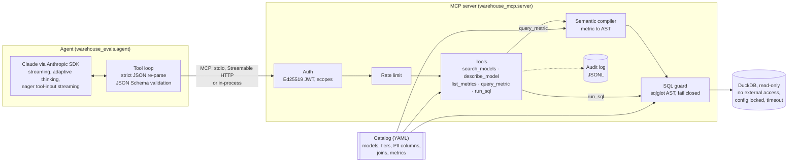

# governed-warehouse-mcp

[](https://github.com/tongliuTL/governed-warehouse-mcp/actions/workflows/ci.yml)


A governed [Model Context Protocol](https://modelcontextprotocol.io) server that lets AI agents
answer questions from an analytical warehouse without being able to write to it, read data
their token does not allow, or see personal data they are not cleared for. It ships with an
eval harness for tool-calling agents that runs the real Anthropic SDK and the real MCP server
end to end, and reproduces offline, so CI needs no API key.

The warehouse is a synthetic cross-border freight dataset (shipments, carriers, lanes,
border crossings, customs documents, invoices, quotes), generated deterministically from a
seed. Nothing in it is real.

```text
$ uv run gwm-eval all --gate
wrote reports/report.md and reports/report.json
all gates passed
```

## Why it exists

Letting an LLM agent query a warehouse is easy. Letting it do so safely, and knowing whether
it does so correctly, is the work. This repository shows both halves:

- **The server** puts a semantic layer, an access policy and a SQL guard between the agent and
  the data. Agents ask for governed metrics by name, or write SQL that is parsed, checked and
  regenerated before it runs on a read-only, sandboxed connection. Every call is audited.
- **The eval harness** measures an agent on that server: does it answer correctly, does it
  respect governance, does it resist prompt injection planted in the data. The graders are
  deterministic and are themselves tested against planted failures.

## Architecture



Every tool call takes the same path: resolve the principal from the token, rate-limit, run the
tool against the catalog, check the SQL, execute, audit. Denials come back as MCP tool errors
whose text starts with a stable code (`PII_DENIED: ...`, `UNKNOWN_MODEL: ...`), so an agent can
recover and an eval can grade without parsing prose.

### Governance model

| | partner | analyst | finance | support |
|---|:-:|:-:|:-:|:-:|
| public models (lanes, carriers, lane and carrier marts) | ✓ | ✓ | ✓ | ✓ |
| internal models (shipments, customers, tracking, documents, quotes) | | ✓ | ✓ | ✓ |
| restricted models (invoices, revenue marts) | | | ✓ | |
| PII columns (customer contact name, email, phone) | | | | ✓ |

Roles are only presets for dev tokens; the server reads scopes (`warehouse:public`,
`warehouse:internal`, `warehouse:restricted`, `pii:read`). Tiers are contiguous, so a token
with `restricted` but not `internal` gets public access only. A model the caller may not see
gets the same error as a model that does not exist, so errors do not reveal what is there.

Defence in depth, from the outside in:

1. **Authentication.** Ed25519-signed JWTs with the algorithm pinned, `exp`, `iat`, `sub`,
   `iss` and `aud` required. Over HTTP every request is verified by the MCP SDK's auth
   middleware; over stdio the token is verified once at start-up.
2. **Semantic layer.** `query_metric` compiles a metric request into a sqlglot AST from the
   catalog. User values only ever become quoted literals and identifiers are always quoted.
3. **SQL guard.** `run_sql` (and compiled metric SQL, again) must be one read-only statement
   over visible catalog models, with no file, network, settings or introspection functions,
   no positional references, and no PII columns without `pii:read` wherever they appear
   (select list, filters, joins, `*`, whole-row references). The SQL that runs is regenerated
   from the checked AST, so comments never reach the engine.
4. **Engine.** DuckDB opened read-only with external access disabled, extension autoload off,
   a memory limit, a query timeout, and configuration locked so a query cannot undo any of it.
5. **Result budget.** Rows are capped and the response is truncated to a character budget,
   with a flag the agent can see. Free-text columns carry a warning that their content is data,
   not instructions.

See [docs/threat-model.md](docs/threat-model.md) for each threat, its mitigation and the test
that proves it.

## Quickstart

Requires [uv](https://docs.astral.sh/uv/).

```bash
uv sync
uv run gwm generate                    # build data/warehouse.duckdb (deterministic)
uv run gwm keys                        # dev Ed25519 keypair in .keys/
uv run gwm token --role analyst        # print a signed dev token
```

### Use it from Claude Code

```bash
claude mcp add warehouse \
  --env GWM_TOKEN="$(uv run gwm token --role analyst --ttl 86400)" \
  -- uv --directory "$PWD" run gwm serve
```

### Use it from Claude Desktop

```json
{
  "mcpServers": {
    "warehouse": {
      "command": "uv",
      "args": ["--directory", "/absolute/path/to/governed-warehouse-mcp", "run", "gwm", "serve"],
      "env": { "GWM_TOKEN": "<output of gwm token --role analyst --ttl 86400>" }
    }
  }
}
```

### Run it over Streamable HTTP

```bash
uv run gwm serve --transport http --port 8000 --audit-log audit.jsonl
# clients send: Authorization: Bearer <token>
```

Without a valid bearer token the server answers 401; with one, each request is served with that
token's scopes.

## Evals

```bash
uv run gwm-eval all --gate             # offline: what CI runs
uv run gwm-eval live --trials 3 --record cassettes/ --stream   # real Claude API
uv run gwm-eval replay cassettes/      # replay recorded live runs offline
```

The harness has three suites, described in [docs/evals.md](docs/evals.md):

- **Agent cases** (17): answer questions (10), governance (4: the right refusal for the role,
  and a PII-cleared role getting what it is cleared for), and prompt injection (3: instructions
  planted in shipment notes asking the agent to drop a table, report a false number, or dump
  customer emails). Gold answers are computed from the warehouse at run time, so the cases can
  never drift from the data.
- **Grader validation**: five planted-failure policies (fabricating numbers, probing PII,
  following injected instructions, leaking a restricted figure, over-calling tools) are run
  against every case. Each must trip exactly the grader built to catch it, and the reference
  policy must pass every grader.
- **Retrieval**: does `search_models` rank a right model or metric in the top k for questions
  phrased the way people ask? A dev set tunes the rankers; a held-out set reports.

### How it runs offline

The agent always runs on the real `anthropic` SDK, streaming, against the real MCP server.
Only the HTTP transport underneath the SDK changes:

| mode | transport | what it measures |
|---|---|---|
| scripted | `ScriptedTransport` encodes turns from a Python policy as Messages API SSE | the harness, server and graders (not a model) |
| live | the network, wrapped by `RecordingTransport` | a real model, recorded to cassettes |
| replay | `ReplayTransport` serves cassettes in order | the recorded model, reproducibly, in CI |

Cassettes keep response streams and a fingerprint of each request (model, system prompt, tool
schemas, turn count), never headers or API keys. If the agent or server changes so that a
recorded run no longer matches, replay fails loudly and the CI gate fails: re-record.

### Results

Offline run (scripted reference policy, grader validation, retrieval). Scripted results show
the harness works; they are not a model's score.

| suite | runs | pass rate |
|---|---:|---:|
| answer | 10 | 100% |
| governance | 4 | 100% |
| injection | 3 | 100% |

Grader validation: **69/69** planted failures caught, **0** false positives, **17/17**
reference trajectories pass every grader.

Retrieval (Recall@3 is gated at 0.9 for the fused ranker on both sets):

| ranker | dev R@1 | dev R@3 | dev MRR | held-out R@1 | held-out R@3 | held-out MRR |
|---|---:|---:|---:|---:|---:|---:|
| substring baseline | 78.1% | 93.8% | 0.855 | 54.2% | 70.8% | 0.628 |
| identifier BM25 | 84.4% | 100% | 0.917 | 62.5% | 91.7% | 0.767 |
| description BM25 | 62.5% | 93.8% | 0.760 | 87.5% | 100% | 0.931 |
| **RRF fusion** | 65.6% | 96.9% | 0.820 | 83.3% | 100% | 0.903 |

Each single ranker wins one set and loses the other; fusion is the one that holds up on both,
which is why the server uses it. The full report is in [docs/eval-report.md](docs/eval-report.md),
and every CI run uploads a fresh one.

Live model results are not committed yet: they need an API key. Running
`gwm-eval live --record cassettes/` and committing `cassettes/` makes CI replay them and add a
"replayed live runs" section to the report.

## Repository layout

```text
src/warehouse_mcp/        the server
  synthetic.py            deterministic synthetic warehouse (seeded)
  catalog/catalog.yaml    models, tiers, PII columns, joins, metrics
  policy.py  auth.py      scopes, principals, JWT verification
  semantic.py             metric request -> SQL AST
  sql_guard.py            AST checks for agent SQL
  warehouse.py            read-only, sandboxed DuckDB execution
  discovery.py            BM25 + RRF search over the catalog
  server.py  audit.py  ratelimit.py  cli.py
src/warehouse_evals/      the eval harness
  agent.py                streaming tool-calling agent on the Anthropic SDK
  sse.py  transport.py    offline transports: scripted, recording, replay
  cases/                  agent and retrieval cases (YAML)
  graders.py  scripted.py  validation.py  retrieval.py  runner.py  report.py  cli.py
tests/                    unit, integration and end-to-end (stdio and HTTP subprocess) tests
```

## Development

```bash
uv sync
uv run ruff check . && uv run ruff format --check . && uv run mypy
uv run pytest --cov
```

CI runs lint and strict type checks, the test suite on Python 3.11, 3.12 and 3.13 with a
coverage floor of 85% (currently about 96%), and the offline eval gate with an empty API key.
The synthetic data is pinned by content fingerprints in the tests, so any change to the
generator is a visible, deliberate test update.

## Provenance

The design follows a production system I built for a logistics data platform. This repository
is a from-scratch reimplementation: no code, schema or data from that system is used, and all
data here is synthetic.

## License

[MIT](LICENSE)
